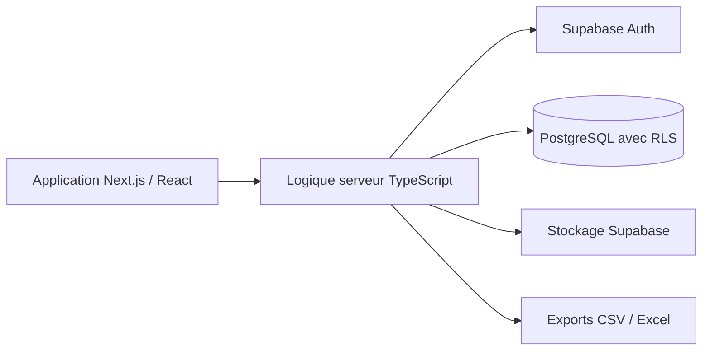

# Ritem

**Gestion des plannings et du temps de travail pour les équipes horaires**

Ritem est un SaaS destiné aux équipes de restauration, de boulangerie et aux autres activités organisées en horaires. Le produit réunit planning, absences, pointage et préparation des éléments de paie dans une application web.

Ce dépôt est une présentation du produit et de son architecture. Il ne contient pas le code de l’application ni de données clients.

## Fonctionnalités

- Planning par jour, semaine et mois, avec déplacement des créneaux et modèles de semaine.
- Gestion des employés, contrats, postes et établissements.
- Demandes d’absence, validation et compteurs de congés.
- Badgeuse et comparaison des heures planifiées et réalisées.
- Rapports et exports de pré-paie au format CSV et Excel.
- Espace manager et espace employé, avec accès selon les rôles.

## Mon rôle

Conception et développement du produit full stack : application Next.js / TypeScript, schéma PostgreSQL, politiques d’accès Supabase et déploiement sur VPS Linux.

## Architecture

## Choix techniques

**Données isolées par entreprise.** Le modèle multi-tenant organise les données par organisation et établissement. Les politiques RLS PostgreSQL limitent leur accès selon l’organisation de l’utilisateur.

**Droits selon les rôles.** Les espaces manager et employé s’appuient sur des contrôles d’authentification et d’autorisation côté serveur.

**Données versionnées.** Le schéma et ses évolutions sont gérés avec les migrations Supabase.

**Déploiement.** L’application utilise Supabase en production et un serveur Next.js hébergé sur VPS Ubuntu, avec pm2, Apache et TLS.

## Stack

| Couche | Technologies |
| --- | --- |
| Interface | Next.js, React, TypeScript, Tailwind CSS, shadcn/ui |
| Authentification et données | Supabase, PostgreSQL, RLS |
| Exports | ExcelJS, CSV |
| Développement local | Supabase CLI, Docker |
| Déploiement | VPS Ubuntu, pm2, Apache, Let’s Encrypt |

## Consulter le produit

[Ouvrir Ritem](https://ritem.pro)

Produit en phase de test auprès d’une première boulangerie. Cette présentation ne fournit pas une version installable ; l’accès au service dépend de son état de déploiement.

---

Projet conçu et développé par [Jorian Gaurin](https://github.com/jgaurin) · [LinkedIn](https://www.linkedin.com/in/jorian-gaurin)
